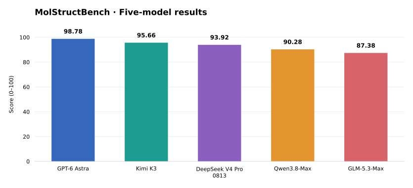

# MolStructBench reference leaderboard

Five agent runs on the fixed 288-question evaluation set. The official score gives equal weight to Native3D, 3D→2D, and Pure2D. All values are on a 0–100 scale.

| Model | MolStructBench Score | Native3D | 3D→2D | Pure2D |
|---|---:|---:|---:|---:|
| GPT-6 Astra | 98.78 | 100.00 | 97.40 | 98.96 |
| Kimi K3 | 95.66 | 95.83 | 93.23 | 97.92 |
| DeepSeek V4 Pro 0813 | 93.92 | 91.67 | 91.15 | 98.96 |
| Qwen3.8-Max | 90.28 | 93.75 | 87.50 | 89.58 |
| GLM-5.3-Max | 87.38 | 85.42 | 85.42 | 91.32 |

## Secondary metrics

| Model | Deterministic | Semantic | Micro |
|---|---:|---:|---:|
| GPT-6 Astra | 100.00 | 96.30 | 98.61 |
| Kimi K3 | 95.56 | 96.76 | 96.01 |
| DeepSeek V4 Pro 0813 | 96.94 | 92.13 | 95.14 |
| Qwen3.8-Max | 91.11 | 87.04 | 89.58 |
| GLM-5.3-Max | 90.56 | 84.72 | 88.37 |

See the [48-task breakdown](examples/history/task_breakdown.csv) and [technical report](docs/technical_report.md) for task-level analysis.
