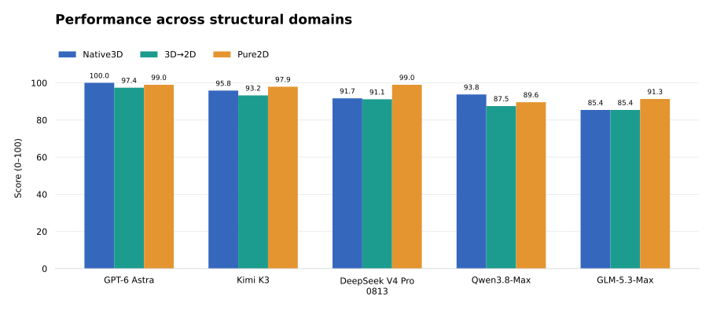

# MolStructBench

Technical report   ·   Version 1.0   ·   October 2026

## Abstract

MolStructBench evaluates how language models interpret molecular graphs and three-dimensional structures, use scientific tools, and ground their answers in specific atoms, bonds, and coordinates. The benchmark contains 288 fixed questions across Native3D, 3D→2D, and Pure2D. Its 48 dataset–task units cover structure grounding, conformational geometry, molecular properties, and medicinal chemistry, with six questions in each unit.

The release includes the questions, complete gold answers, an official local scorer, and an optional OpenCode agent harness. Deterministic evaluation handles 180 questions; 108 use a frozen Qwen3.8-Max judge with three independent votes and median aggregation. Five archived model runs are scored by the same procedure. Their MolStructBench Scores range from 87.38 to 98.78 out of 100. All predictions and archived judge votes needed to reproduce these scores are included.

## 1 Benchmark design

Each question supplies a molecular representation and a task with explicit chemical rules. The model returns atom indices, bond endpoints, three-dimensional bounding boxes, a molecular identity, or a chemical explanation. Evaluation checks both the scientific content and its connection to the supplied structure. The task contract defines the input representation, required facts, and output format.

| Domain | Task units | Questions | Input emphasis |
| --- | --- | --- | --- |
| Native3D | 8 | 48 | Atoms, bonds, coordinates |
| 3D→2D | 16 | 96 | Topology derived from 3D sources |
| Pure2D | 24 | 144 | SMILES and indexed graphs |
| Total | 48 | 288 | 153 English and 135 Chinese |

We selected the 288 questions from a 940-question pool using intrinsic molecular and task features. In 44 units, the selection contains one easy, two medium, and three hard questions. Four knowledge and identification units contain two questions at each of three structural-complexity levels. Selection also balances labels, languages, query types, and chemical diversity. The fixed ID list defines the evaluation set.

### Structural domains

### Native3D

The eight Native3D units use explicit atom, bond, and coordinate records. They ask the model to locate functional groups, rotatable bonds, stereocenters, pharmacophore relations, and regions associated with hydrogen-bond contact or torsion changes. Grounding is scored against ordered spatial boxes, with a 0.01 Å tolerance where specified. Stereocenter tasks also require the CIP label. Both the chemical identification and the spatial location contribute to correctness.

The conformer-energy unit is a stored-energy comparison control. Each question provides the source energies of two conformers and asks for the higher-energy conformer. The unit evaluates comparison of the supplied values and contributes to the official score.

### 3D to 2D and Pure2D

The 16 units in 3D→2D work with molecular topology derived from three-dimensional source structures. They combine exact atom-level grounding with scaffold descriptions, functional-group questions, graph comparisons, and property explanations. Pure2D adds eight further units, including bond localization, ring-system grounding, parent standardization, molecular identification, and target or mechanism knowledge. The full catalog appears in the appendix.

Inputs are supplied as text records, indexed graphs, SMILES, and coordinate tables. The three domains distinguish the structural information available to the model. Chemical explanations and localization answers can be checked against the atoms, bonds, and coordinates in the molecular record.

## 2 The agent harness

The supplied harness retains the OpenCode CLI agent loop and exposes a single scientific_shell tool. A model can write a calculation, receive its result, revise its approach, and produce a final answer. The shell provides Python with RDKit, NumPy, SciPy, pandas, and NetworkX for graph analysis, geometry, descriptors, and numerical work. Profile A gives each solver the same public prompt, tool access, runtime policy, and output schema.

Provider adapters connect OpenAI-compatible Chat Completions, the Responses API, and local OpenAI-compatible endpoints such as a configured vLLM service. Each adapter presents the same scientific task and tools to the model. The OpenCode integration requires native tool calling and model continuation after tool results.

### Runtime and records

Each question runs in its own session and workspace. Scientific code executes in the Linux bubblewrap sandbox with bounded time, memory, and output. The tool workspace contains the public input and permitted working files. Gold answers and scoring facts are loaded only in the evaluation stage and are excluded from solver system, user, and tool messages.

| Release runtime setting | Value |
| --- | --- |
| Model calls | 24 ordinary calls plus one finalization call |
| Tool calls | 32 maximum |
| API request timeout | 1800 seconds |
| Whole-question timeout | 7200 seconds |
| Scientific tool timeout | 180 seconds |
| API attempts | Up to 3 with finite backoff |

Soft budget reminders occur at 18 model calls and 20 tool calls. Rate limits, server failures, and transport timeouts receive bounded retries. Scientific answer errors and errors in model-written Python are recorded within the current attempt. Checkpoints support resume after interruption. The harness writes predictions, execution records, tool statistics, and provider usage as separate outputs. The table describes the published runtime policy; historical runs retain their original configurations and provenance.

## 3 Official scoring

### Deterministic evaluation

The deterministic scorer checks the public task contract against complete gold and accepted variants. Depending on the task, this means comparing atom sets, sets of atom groups, bond indices or endpoints, canonical structures, class labels, names, or spatial boxes. If the contract permits multiple valid targets, the accepted set records those alternatives. The rules apply to every model through one scorer.

The parser extracts the final answer from JSON, fenced JSON, tables, and natural-language wrappers. It normalizes equivalent forms and deduplicates repeated results. Final-answer extraction separates the submitted conclusion from candidate indices, coordinates, and R/S labels discussed earlier. Contradictions within the submitted conclusion remain part of the scored answer. Molecular names accept documented synonyms, including bilingual and parenthetical forms.

Molecular identity tasks first use deterministic name and identity matching. Eligible unresolved identities use the frozen three-vote judging procedure to assess chemical equivalence across naming conventions.

### Semantic evaluation

The semantic judge receives the question, task specification, structured reference facts, frozen public evidence, and the final answer. It receives no solver identity, reasoning trace, or tool history. Qwen3.8-Max is anonymized in exactly the same way when its own solver answers are judged.

The judge evaluates the task contract using the structured reference facts. Reference answers allow other valid expressions of the same chemistry; tasks with a closed ontology specify that restriction explicitly. The judge accepts chemically equivalent descriptions, synonyms, and additional scientifically correct facts. Contradictions with required facts and omissions of required content lower the grade.

| Judge setting | Frozen value |
| --- | --- |
| Model | qwen3.8-max |
| Thinking and reasoning effort | Enabled and high |
| Temperature | 0.6 |
| Maximum output tokens | 8192 per request |
| Votes | 3 independent requests |
| Grade | 0 incorrect · 1 partial · 2 fully correct |

Each vote is scaled from 0/1/2 to 0/0.5/1, and the median of the three votes is the sample score. Judge requests and cached votes carry hashes of the model configuration, prompt, and anonymous input. Unsuccessful API requests remain pending for resume. Aggregation starts when every required vote is available.

### Aggregation

First, the scorer averages the six sample scores within each dataset–task unit. It then averages the unit scores within each domain. The final MolStructBench Score is 100 times the equal-weight mean of the Native3D, 3D→2D, and Pure2D domain scores. Each domain therefore contributes one third of the headline score, although their question counts differ.

Deterministic and semantic averages summarize the two scoring methods. The micro average gives equal weight to each question. These secondary metrics accompany the official domain-weighted score. Scores on the 0–100 scale include partial semantic credit.

### Scoring reproducibility

The data selection, evaluator, accepted variants, judge template, and configuration are versioned together. Historical replay reads the packaged predictions, judge inputs, and completed votes, computes each sample grade, and applies the official aggregation. The same scorer produces the reference leaderboard and scores new prediction files.

## 4 Five model results

Five agent runs were evaluated on the same 288 questions with the official scorer. The results comprise 1,440 predictions and 1,665 completed judge votes: three votes for each of 540 semantic answers, plus 45 votes for 15 molecular-identity fallbacks. Table 1 reports the official scores and domain breakdown.

Table 1   Official scores and domain breakdown on a 0 to 100 scale

| Model | Score | Native3D | 3D→2D | Pure2D |
| --- | --- | --- | --- | --- |
| GPT-6 Astra | 98.78 | 100.00 | 97.40 | 98.96 |
| Kimi K3 | 95.66 | 95.83 | 93.23 | 97.92 |
| DeepSeek V4 Pro 0813 | 93.92 | 91.67 | 91.15 | 98.96 |
| Qwen3.8-Max | 90.28 | 93.75 | 87.50 | 89.58 |
| GLM-5.3-Max | 87.38 | 85.42 | 85.42 | 91.32 |

GPT-6 Astra has the highest aggregate score at 98.78, followed by Kimi K3 at 95.66 and DeepSeek V4 Pro 0813 at 93.92. Qwen3.8-Max scores 90.28, and GLM-5.3-Max scores 87.38. Astra scores 100 on Native3D; Astra and DeepSeek both reach 98.96 on Pure2D. Domain scores separate these aggregate results: Qwen performs better on Native3D than on either topological domain, while Kimi and DeepSeek obtain their strongest results on Pure2D.

Table 2   Secondary metrics on a 0 to 100 scale

| Model | Deterministic | Semantic | Micro |
| --- | --- | --- | --- |
| GPT-6 Astra | 100.00 | 96.30 | 98.61 |
| Kimi K3 | 95.56 | 96.76 | 96.01 |
| DeepSeek V4 Pro 0813 | 96.94 | 92.13 | 95.14 |
| Qwen3.8-Max | 91.11 | 87.04 | 89.58 |
| GLM-5.3-Max | 90.56 | 84.72 | 88.37 |

The secondary metrics help locate the source of a difference. DeepSeek scores 96.94 on deterministic tasks and 92.13 on semantic tasks; Kimi scores 95.56 and 96.76, respectively. The headline score also depends on where those results fall across the three equally weighted domains. The released per-question records and 48-unit breakdown allow readers to examine that structure directly.

### Performance across structural domains

Figure 1   Scores for the five reference models across Native3D, 3D→2D, and Pure2D. Each bar is the mean of the task-unit scores in that domain, on a 0–100 scale.



Performance differs across structural representations. The Native3D scores range from 85.42 to 100, the 3D→2D scores from 85.42 to 97.40, and the Pure2D scores from 89.58 to 98.96. These domain means summarize localization and reasoning tasks with different inputs. The equal-weight aggregation gives each domain the same contribution to the final score.

Astra leads on Native3D and 3D→2D and ties DeepSeek on Pure2D. Kimi exceeds DeepSeek on both Native3D and 3D→2D, while DeepSeek scores higher on Pure2D. Qwen scores higher than GLM on Native3D and 3D→2D; GLM scores higher on Pure2D. The 48-task breakdown resolves these domain differences into specific chemical and structural tasks.

## 5 What the task breakdown reveals

### Strict rotatable bonds

In Native3D rotatable-bond grounding, Astra answers all six questions correctly, Kimi four, and the other three models three each. The unit uses a strict rotatable-bond definition and requires spatial localization of the selected bond. Applying that definition to the molecular graph is a substantial part of the task.

### Scaffold boundaries

In 3D→2D scaffold-core grounding, Astra and DeepSeek score 100, GLM 83.33, Kimi 66.67, and Qwen 33.33. Answers must identify the exact indexed atoms belonging to the scaffold core. Exocyclic atoms, fused rings, and substituent attachment points make the core boundary sensitive to the chemical definition used.

### Hydrogen bond explanations

In the 3D→2D hydrogen-bond source explanation unit, scores range from 58.33 to 100. The answer must explain donor and acceptor behavior in the atom’s chemical environment. Protonation, resonance, and functional-group context can change that role. The unit tests whether a model connects those chemical factors to the supplied structure.

### Molecular identity

Pure2D molecular identification shows a substantial spread: Astra scores 100 and Qwen 33.33. In two Qwen answers, glasdegib was identified as WAY-267464 and cefixime as ceftibuten. Both answers named a different compound. These cases show how recognition of familiar structural motifs can lead to an incorrect molecular identity.

### Computing and then using the result

A pairwise property answer from Qwen recognized that both structures had zero rotatable bonds under the strict rule, then used broader counts of three and one to declare A more rotatable. The final comparison used a different definition from the question. This case tests whether the model carries the specified chemical rule through its calculation and into the final decision.

The task-level results distinguish chemical explanation, structural membership, and the final decision. Exact localization exposes boundary errors; property comparisons reveal how a model applies a chemical definition; molecular identification tests whether a complete structure supports the proposed name. Together, these records provide a concrete account of performance across the benchmark.

## 6 Open source release and reproduction

MolStructBench publishes its questions and gold answers together. The repository includes accepted variants, the task catalog, the deterministic evaluator, the judge prompt and configuration, and the official aggregation. Researchers can inspect the scientific targets and run the scorer locally. During evaluation, the solver reads the question inputs and the scorer loads the gold in a separate stage.

| Edition | Included components |
| --- | --- |
| With harness | Data, gold, local scorer, OpenCode agent, scientific_shell |
| Without harness | The same data, gold, and local scorer for an external runner |

Both editions produce the same official score for the same prediction file. The core edition connects to external model or agent frameworks through the standard prediction format. The full edition supplies the OpenCode runner and Profile A scientific tool environment. Reporting the model, benchmark version, and execution profile identifies the experimental setup.

### Running and scoring locally

On Linux or WSL with Python 3.10, the full edition installs its pinned environment and OpenCode binary. Copy a provider example to a separate configuration file, choose a model that supports tool continuation, and supply API credentials through environment variables. A typical workflow is:

```bash
bash scripts/install_environment.sh
source .runtime/venv/bin/activate
cp configs/chat.json my_model.json
# Configure the model and endpoint in my_model.json
export OPENAI_API_KEY="YOUR_SOLVER_KEY"
molstructbench eval --model MODEL_ID \
  --config my_model.json --output runs/model
export DASHSCOPE_API_KEY="YOUR_JUDGE_KEY"
molstructbench score --predictions runs/model/predictions.jsonl \
  --output scores/model
```

Scoring runs locally, with semantic requests authenticated by the user’s DashScope key. Checkpoints and judge caches retain completed votes for resume. The scorer writes final_results.json, per-sample scores, the three-domain and 48-task breakdowns, and judge usage statistics.

### Reproducing the reference leaderboard

```bash
python scripts/verify_release.py
python -m unittest discover -s tests -v
python scripts/gold_selftest.py
python scripts/reproduce_history.py --output results/history
```

Historical replay runs offline using the packaged predictions and completed judge votes. The commands above check the dataset, run the test suite, verify all 180 deterministic gold answers, and reproduce the five-model leaderboard.

## 7 Task contracts in practice

Task contracts specify the chemical interpretation used in scoring. For example, the metabolic-liability contract defines a long alkyl chain as at least five consecutive non-ring sp3 carbon atoms. The model must check atom type, hybridization, ring membership, and connectivity to identify a qualifying chain. The question, gold facts, and evaluator use this same definition.

The benchmark’s public representations make it possible to inspect an answer against atoms, bonds, and coordinates. They also make the failure cases interpretable: a wrong atom set, a reversed comparison, an unsupported identity, or an explanation that contradicts the molecule. The stored-energy control has a deliberately simpler role within that task set. Every unit keeps its declared scoring contract and official weight.

## 8 Conclusion

MolStructBench brings molecular explanations and structural localization into one reproducible evaluation. The same question can require chemical knowledge, a graph or geometric calculation, and a precise final answer. Its two release editions share one dataset and one local scoring system, so researchers can use the supplied OpenCode agent or integrate their own runner. The archived five-model results provide an immediately reproducible reference, while the task catalog and per-question records show how to interpret new results beyond a single headline score.

## Implementation references

OpenCode supplies the agent loop. The implementation separates task data, execution, prediction artifacts, and evaluation, following the organization of established benchmark repositories. AstaBench, SWE-bench, MLE-bench, and the LM Evaluation Harness provide reference implementations for scientific agents, executable environments, prediction records, and common model interfaces.

- [OpenCode](https://github.com/anomalyco/opencode)

- [AstaBench](https://github.com/allenai/asta-bench)

- [SWE-bench](https://github.com/SWE-bench/SWE-bench)

- [MLE-bench](https://github.com/openai/mle-bench)

- [LM Evaluation Harness](https://github.com/EleutherAI/lm-evaluation-harness)

## Appendix The 48 task units

A unit is a dataset–task combination, with six questions in every unit. The catalog contains 48 units and 33 distinct task-type names. Several task types occur in both topological domains. Display names below replace underscores with spaces; the machine-readable catalog retains the exact identifiers.

### Native3D   8 units

| Task | Scoring target |
| --- | --- |
| conformer energy ranking | Stored energy |
| functional group bbox grounding 3d | 3D boxes |
| hbond contact change grounding 3d | 3D boxes |
| pharmacophore relation grounding 3d | 3D boxes |
| rotatable bond bbox grounding 3d | 3D boxes |
| shared functional group pair grounding 3d | 3D boxes |
| stereocenter grounding 3d | 3D box and CIP |
| torsion change grounding 3d | 3D boxes |

### 3D to 2D   16 units

| Task | Scoring target |
| --- | --- |
| anchor atom grounding | Atom set |
| drug likeness | Semantic |
| functional group grounding | Atom groups |
| functional group qa | Semantic |
| hydrogen bond source explanation | Semantic |
| metabolic liability | Semantic |
| molecule caption | Semantic |
| pairwise analog classification | Class or label |
| pairwise graph diff | Semantic |
| pairwise property comparison | Semantic |
| permeability solubility | Semantic |
| scaffold core grounding | Atom set |
| scaffold fragment caption | Semantic |
| simple ring grounding | Atom set |
| single instance functional group grounding | Atom groups |
| single substituent grounding | Atom groups |

## Appendix Task catalog continued

### Pure2D   24 units

| Task | Scoring target |
| --- | --- |
| anchor atom grounding | Atom set |
| attachment bond endpoint grounding | Bond endpoints |
| bond grounding | Bond target |
| database grounded knowledge caption | Semantic |
| drug likeness | Semantic |
| full form parent standardization | Canonical structure |
| functional group grounding | Atom groups |
| functional group qa | Class or label |
| identity with structural evidence | Semantic |
| known target mechanism | Semantic |
| metabolic liability | Semantic |
| molecule caption | Semantic |
| molecule identification | Molecular identity |
| pairwise analog classification | Class or label |
| pairwise graph diff | Semantic |
| pairwise property comparison | Semantic |
| permeability solubility | Class or label |
| ring system grounding | Atom set |
| scaffold core grounding | Atom set |
| scaffold fragment caption | Semantic |
| scaffold grounding | Core and groups |
| simple ring grounding | Atom set |
| single instance functional group grounding | Atom groups |
| single substituent grounding | Atom groups |

Semantic means three-vote median judging. Molecular identity uses deterministic matching with an eligible identity fallback. All target definitions, output requirements, and accepted alternatives are specified in the released task contracts and scorer assets.
